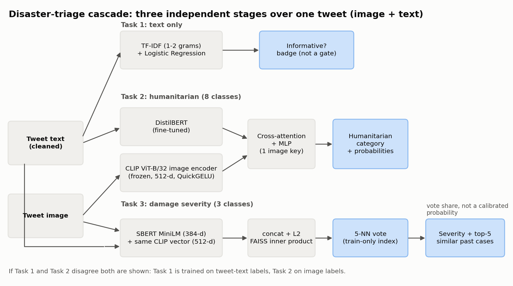
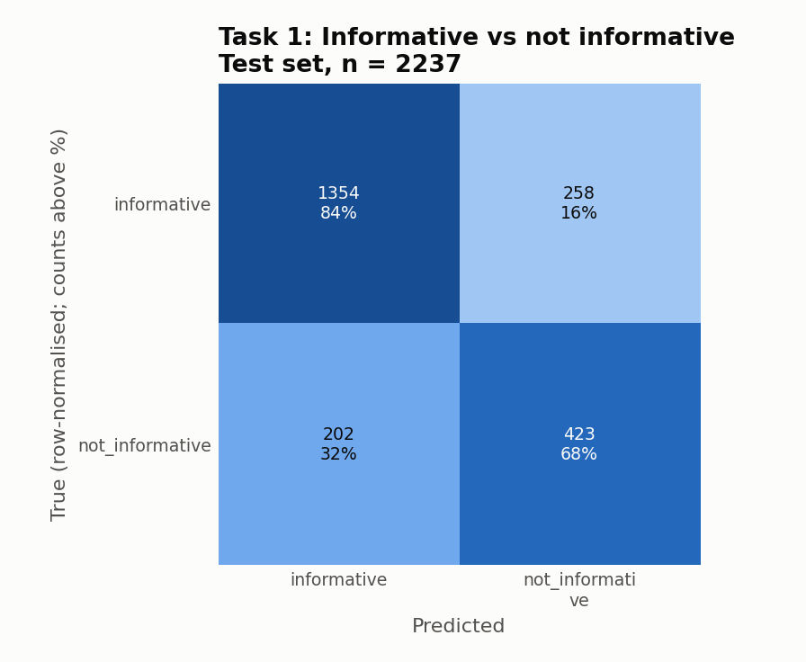
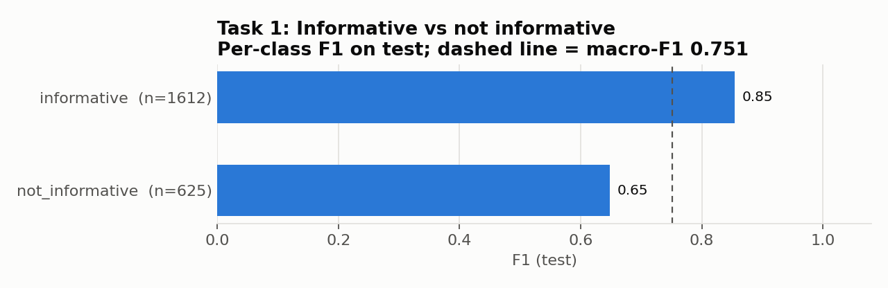
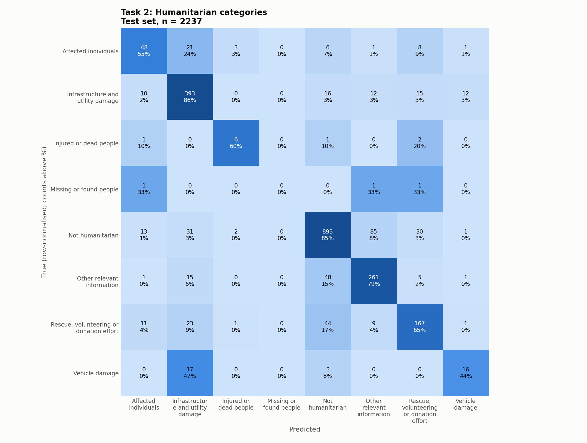
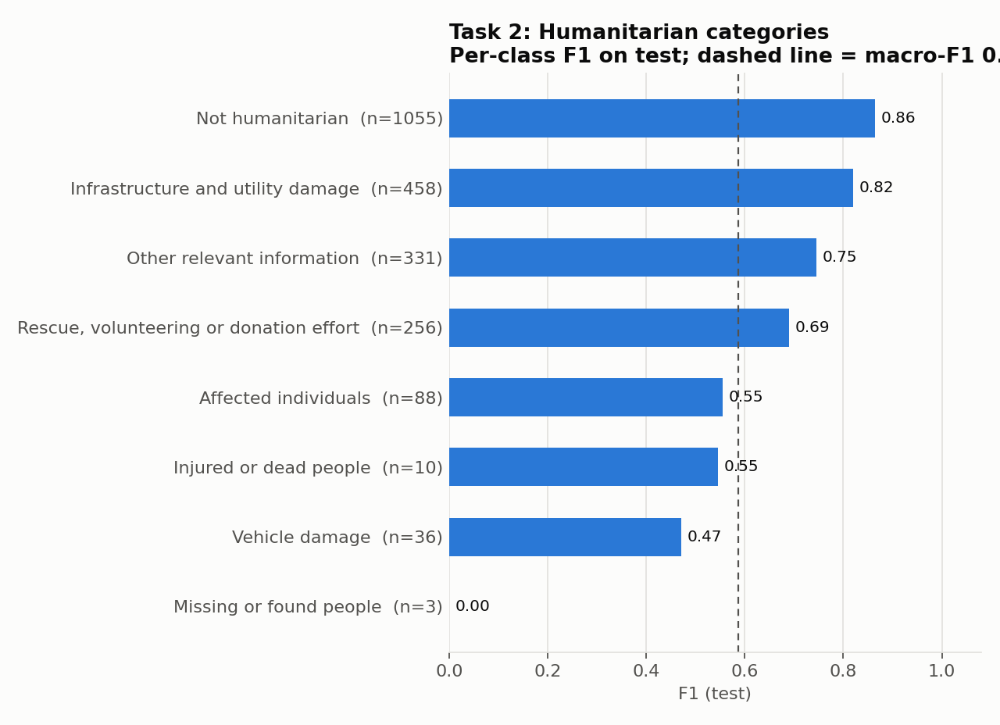
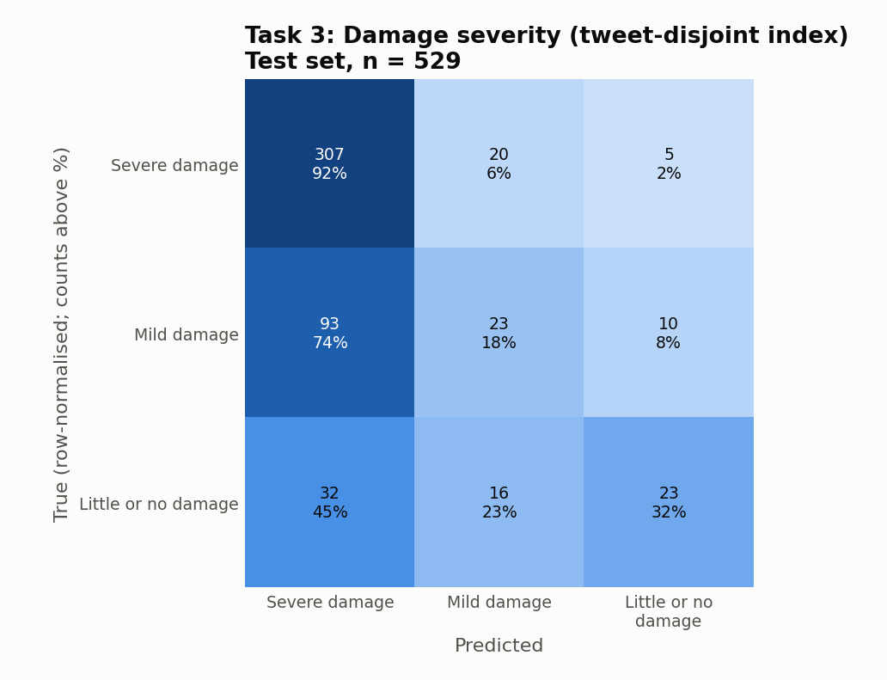
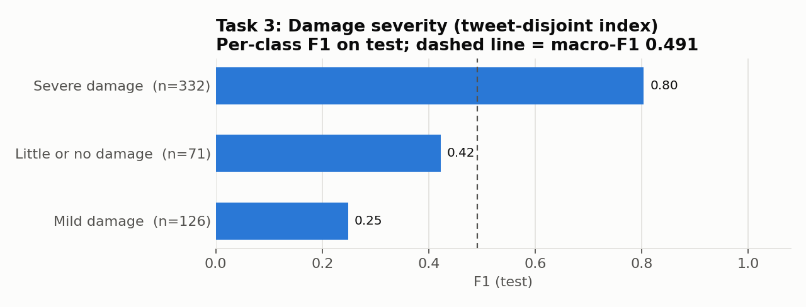

# CrisisMMD pipeline: audit, corrections and results

## 1. Bug audit

| # | Bug | Why it mattered | Fix |
|---|---|---|---|
| 1 | `str.lstrip('data_image/')` strips a **character set**, not a prefix. `iraq_iran_earthquake` became `raq_iran_earthquake` and `mexico_earthquake` became `xico_earthquake`. | The image lookup failed, so those two events were silently dropped, along with about 11% of every split (e.g. informative train 12112/13608 rows survived). | `removeprefix('data_image/')`. After the fix 100% of images resolve in every split; asserted. |
| 2 | Task 3 FAISS index was built from **all** annotation files, which include the test images. | Each test query could retrieve itself (see section 2). | Index built from the damage **train** split only; evaluated on damage **test**; `image_id` and `tweet_id` intersections asserted empty. |
| 3 | Task 1 report: sklearn sorts labels alphabetically (`informative`, `not_informative`) but `target_names` was passed reversed. | Per-class precision/recall were attached to the wrong names. Headline accuracy was unaffected. | `labels=` passed explicitly. |
| 4 | `T3_CLIP` / `T3_CLIP_PROC` used but never defined. | The notebook only ran because of stale Kaggle kernel state. | Defined explicitly (HF `openai/clip-vit-base-patch32` + `CLIPProcessor`). |
| 5 | No way to run without retraining. | Reproduction required hours of training. | `TRAIN` flag; `False` loads from `artifacts/`. |
| 6 | **QuickGELU mismatch.** The old Task 2 loaded `open_clip` ViT-B/32 with `pretrained='openai'`, which warned `QuickGELU mismatch (quick_gelu=False) vs pretrained tag 'openai' (quick_gelu=True)`. | The OpenAI weights were trained with QuickGELU, so the old image features used the wrong activation. | HF `CLIPModel`, which uses QuickGELU for this checkpoint (asserted in the notebook). One CLIP now serves Tasks 2 and 3. |
| 7 | Task 3 vote used `max(set(labels), key=labels.count)`. | Ties were broken by Python set-hash order. | Ties broken by summed neighbour similarity (deterministic). |
| 8 | Task 3 split overlap by tweet (found during the fix): the official split separates images, not tweets, so a tweet with two images can appear in two splits with identical text. | 62 test tweets (67 rows) have a twin in train; their text embeddings match exactly. | The 107 train rows sharing a tweet with test are left out of the index (logged). The official-split number is reported as a secondary row. |

## 2. Why corrected Task 3 dropped by less than one might expect

The old Task 3 index had two opposing defects, which together probably explain why the old number was not dramatically higher than the corrected one. This is an explanation of the likely mechanism, **not a measured ablation**.

* **Inflation (self-match).** The index contained the test images themselves, so each test query retrieved itself as a neighbour. That is one guaranteed-correct vote out of five.
* **Deflation (absent class).** The annotation files contain 18,082 rows, and 14,455 of them have no damage label, which the old code mapped to "Don't know or can't judge". The old index therefore held 14,556 "Don't know" vectors (80.5% of the index), while the official damage splits contain no such class. Neighbours voting for a class that cannot occur in the test set can only cost accuracy.

These two effects pull in opposite directions and plausibly roughly cancelled. Removing both gives a result that is smaller on accuracy and weighted-F1 but is at least a valid evaluation.

**Tweet-disjoint splits are the dataset authors' own principle.** Ofli et al. assigned all multi-image tweets to the training set specifically so that no tweet text repeats across train, dev and test. `datasplit_all` does not enforce this for the damage task (62 tweets have one image in train and another in test; 16 are shared between dev and test), so our tweet-disjoint index applies the same principle to the damage split.

## 3. Before/after table (test split)

| Task | Version | Accuracy | Macro-F1 | Weighted-F1 | n (test) |
|---|---|---|---|---|---|
| T1 Informative (text-only) | old | 0.7944 | not reported | 0.7970 | not reported |
| | corrected | 0.7944 | 0.7513 | 0.7970 | 2237 |
| T2 Humanitarian (8 classes) | old | 0.7807 | 0.4696 | not reported | not reported |
| | corrected pipeline* | 0.7975 | 0.5865 | 0.7968 | 2237 |
| T3 Damage (3 classes) | old | 0.6784 | not reported | 0.6964 | not reported |
| | corrected, tweet-disjoint index (headline) | 0.6673 | 0.4914 | 0.6202 | 529 |
| | corrected, official split (image-disjoint only), secondary | 0.6749 | 0.5091 | 0.6309 | 529 |

> **Note:** the demo serves the ablation study's L4a seed-42 Task 2 model (0.8033 / 0.6080); the numbers listed in this table are for the v2 pipeline.

\* "Corrected pipeline" for Task 2 bundles **five** changes: the path fix, HF CLIP / QuickGELU fix, cached embeddings, a 10-epoch cap, and AMP. The delta is not attributable to any single one of them.

**Footnote (old vs corrected are not on identical test sets).** The old rows were evaluated on test sets that were missing the Iraq-Iran and Mexico earthquake samples because of the path bug (e.g. old humanitarian test 1988 of 2237 rows). Old and corrected numbers therefore do not describe the same test sets.

Task 1 reproduces the old accuracy and weighted-F1 to three decimals (it is text-only and never used image paths); only the per-class labels changed.

## 3b. Reference baseline (indicative only: different split and different label set)

Reference: Ofli, Alam, Imran 2020 (arXiv:2004.11838), numbers checked against the arXiv PDF. Their F1 appears to be weighted (it tracks accuracy closely), although the paper does not name the averaging, so it is compared against our **weighted-F1**.

| Task | Source | Setup | Accuracy | F1 |
|---|---|---|---|---|
| Informative, **text-only** (like-for-like with our T1) | Ofli et al. | agreed-label split | 80.8 | 80.9 |
| | **This work (T1)** | `datasplit_all`, text-only | 79.44 | 79.70 (weighted) |
| Informative, multimodal | Ofli et al. | agreed-label split | 84.4 | 84.2 |
| | This work | no multimodal informative model (our T1 is text-only) | n/a | n/a |
| Humanitarian, multimodal | Ofli et al. | agreed-label split, **5 classes** | 78.4 | 78.3 |
| | **This work (T2)** | `datasplit_all`, **8 classes** | 79.75 | 79.68 (weighted) |

Differences that make every row **indicative only**:

1. **Split.** The paper evaluates the agreed-label split (only tweet-image pairs whose text and image labels agree), which removes the ambiguous cases. We use `datasplit_all`.
2. **Humanitarian label set.** The paper uses 5 classes: injured/dead people and missing/found people are merged into affected individuals, and vehicle damage is merged into infrastructure. Ours has 8 classes (including Not humanitarian and the small classes that are hardest to predict), so the tasks differ in difficulty.
3. **Informative modality.** Their 84.4 / 84.2 is a multimodal result; our Task 1 is text only, so the like-for-like row is their text-only result (80.8 / 80.9).

## 3c. Task 2 test results by event (macro over classes present in each event)

| Event | n | Accuracy | Macro-F1 | Weighted-F1 |
|---|---|---|---|---|
| california_wildfires | 216 | 0.7685 | 0.5860 | 0.7646 |
| hurricane_harvey | 572 | 0.7990 | 0.6842 | 0.7981 |
| hurricane_irma | 559 | 0.7996 | 0.5313 | 0.8019 |
| hurricane_maria | 518 | 0.8127 | 0.5192 | 0.8066 |
| iraq_iran_earthquake | 73 | 0.7397 | 0.5386 | 0.7528 |
| mexico_earthquake | 176 | 0.7557 | 0.5980 | 0.7607 |
| srilanka_floods | 123 | 0.8618 | 0.5965 | 0.8648 |

The two events that the old path bug removed (Iraq-Iran, Mexico) are in the test set now and score within the range of the others. Small events have few samples per class, so their macro-F1 is noisy.

## 4. Split integrity

* `image_id` is disjoint across train/dev/test in all three tasks (asserted).
* The Task 1 and Task 2 official splits were verified **tweet-disjoint**; one Task 2 test row has identical cleaned text to a train row, which is negligible.
* Task 3 (damage) has one row per image, so tweets with several images straddle splits: 62 tweets (67 test rows) are shared between train and test, and **16 tweets are shared between dev and test**. Test results are unaffected, since nothing in Task 3 is fitted or tuned on dev (k is fixed at 5). The headline index excludes train rows sharing a tweet with test, and the Task 3 dev number is computed with an index that excludes train rows sharing a tweet with dev. Counts per pair are in `results/split_overlap.csv`. Effect on the Task 3 dev number (measured): accuracy / macro-F1 / weighted-F1 = 0.6730 / 0.4972 / 0.6379 with the full train index, versus 0.6635 / 0.4832 / 0.6291 with the tweet-disjoint index, i.e. twins inflated dev slightly.

## 4b. Architecture

* **Task 1 (informative):** cleaned tweet text, TF-IDF (1-2 grams, 50k features) and class-balanced Logistic Regression. Text only; its output is a badge in the demo and never gates the other stages.
* **Task 2 (humanitarian, 8 classes):** a frozen CLIP ViT-B/32 image encoder (one 512-d vector per image, computed once and cached) and a fine-tuned DistilBERT text encoder, joined by two cross-attention blocks (d_model 256, 4 heads) and an MLP. Trained for at most 10 epochs with AMP, class-weighted cross-entropy, best checkpoint chosen on **dev** macro-F1 (epoch 8).
* **Task 3 (damage severity, 3 classes):** CLIP image vector (512-d) concatenated with an SBERT all-MiniLM-L6-v2 text vector (384-d), L2-normalised, searched with an exact FAISS inner-product index built from the damage **train** split only (2361 vectors after the tweet-disjoint exclusion). The prediction is a 5-nearest-neighbour vote; the vote share is not a calibrated probability.
* All models are loaded from `artifacts/` with `HF_HUB_OFFLINE=1`; weights are not committed to git.

## 4c. Figures

**Task 1**

**Task 2**

**Task 3**

## 4d. Demo

`demo/app.py` (Gradio) loads everything once and returns the Task 1 badge, Task 2 probability bars, the Task 3 vote share, and the five most similar past cases. If Task 1 and Task 2 disagree, both are shown with an explanation (Task 1 is trained on tweet-text labels, Task 2 on image labels). On the RTX 4050 the model call takes about 0.1-0.2 s per prediction and an end-to-end request about 1.8 s (measured through the Gradio API with 3 preloaded examples and 1 fresh upload).

The six preloaded examples are test-split tweets with no tweet_id, text or image twin in the damage-train split (asserted in `tools/select_examples.py`), chosen by their true labels. Running them: 4 of the model's predictions are wrong, all disclosed below.

| Example | Wrong prediction |
|---|---|
| iraq_iran_earthquake, "I am alive..." | Task 3: predicted Severe, true Mild |
| hurricane_irma, "Restoration of Water Supply..." | Task 3: predicted Mild, true Little or no damage |
| hurricane_harvey, "A picture worth a thousand words..." | Task 2: predicted Affected individuals, true Rescue/volunteering/donation |
| hurricane_irma, "Cuba announces program to repair..." | Task 2: predicted Infrastructure and utility damage, true Affected individuals |
## 5. Limitations

* **Task 3 Mild-damage recall is 18%** (Severe 92%, Little or no damage 32%). Severe dominates the train split (1548 of 2468 rows), so the k=5 majority vote is biased towards it. Distance-weighted or class-balanced voting, tuned on dev, is listed under future work and was not implemented.
* **Task 3 is nearest-neighbour retrieval**, not a trained classifier: it can only echo labels of past cases, and the vote share is not a probability.
* **Task 2 cross-attention.** The image side is one pooled CLIP vector, so the txt-to-img attention attends over a single key and is effectively a projection. It was not redesigned.
* **Tiny classes.** "Missing or found people" has 3 test samples (F1 = 0) and "Injured or dead people" has 10, so Task 2 macro-F1 is noisy; differences of a point or two between epochs or runs are not meaningful.
* **Task 2 "after" is a bundle of five changes** and its improvement cannot be attributed to any single one; one training run (seed 42), no repeated runs, and AMP/cuDNN training is not bit-reproducible, so a re-train will give slightly different numbers. The saved artifacts reproduce the reported test metrics exactly (`TRAIN=False`).
* **Old vs corrected rows are not on identical test sets** (see the footnote in section 3).
* **Label sources differ across tasks.** Task 1 uses the tweet-text label, Task 2 the image label, so the two can legitimately disagree on the same tweet.
* **Event and domain shift.** All events are 2017 disaster tweets; the split mixes events, so the numbers say nothing about an unseen event (leave-one-event-out is future work).
* **Demo checks.** The live app was verified through its API (4 cases, all four outputs returned) but not visually in a browser (the browser extension was not connected).

## 6. Future work

* **Distance-weighted / class-balanced voting** for Task 3, tuned on dev. **If anything is ever tuned on Task 3 dev, the 16 dev/test shared tweets must be excluded first.**
* Leave-one-event-out generalisation.
* Zero-shot VLM (LLaVA).
* Patch-token cross-attention for Task 2.
* Satellite imagery (xBD).

## 7. Extra experiment S1: CLIP zero-shot damage severity (added after the headline results; headline tables unchanged)

Same 529 damage-test rows. Three prompt sets were fixed in `results/s1_prompts.json` (committed before any result), one was chosen by **dev** macro-F1 (E3: 0.338, vs E1 0.310 and E2 0.316), and test was scored once. Class embeddings are the re-normalised mean of L2-normalised projected CLIP text embeddings; prediction is the argmax cosine similarity.

| Method | Acc | Macro-F1 | Weighted-F1 | Recall Severe / Mild / Little |
|---|---|---|---|---|
| Task 3 k-NN, image + text (headline) | 0.667 | 0.491 | 0.620 | 92% / 18% / 32% |
| Task 3 k-NN, CLIP image only (same index, k=5) | 0.675 | 0.507 | 0.641 | 91% / 27% / 28% |
| CLIP zero-shot (E3) | 0.303 | 0.299 | 0.349 | 26% / 37% / 38% |
| Zero-shot + dev-fitted bias terms (not pure zero-shot; dev macro-F1 0.465, test 0.397) | 0.567 | 0.397 | 0.563 | 74% / 37% / 8% |
| Always "Severe damage" | 0.628 | 0.257 | 0.484 | 100% / 0% / 0% |
| Stratified random (expected, analytic) | 0.469 | 0.333 | 0.469 | 63% / 24% / 13% |

Zero-shot is below the random baseline, so there is no usable training-free damage classifier here; the labelled index is what carries Task 3. The tweet text adds nothing measurable (0.491 vs 0.507 macro-F1). Feature sanity checks (`results/s1_sanity.txt`): text features equal `text_projection(text_model.pooler_output)` exactly; cached image features match the projected vision output (cosine 1.0, max abs difference 5.7e-3); cat-vs-disaster picks "disaster" for 20/20 images; matched cosine similarities are 0.22-0.29. Caveats: the dev-fitted biases did not transfer cleanly (dev 0.465 vs test 0.397), and the bias grid was searched on dev only.
